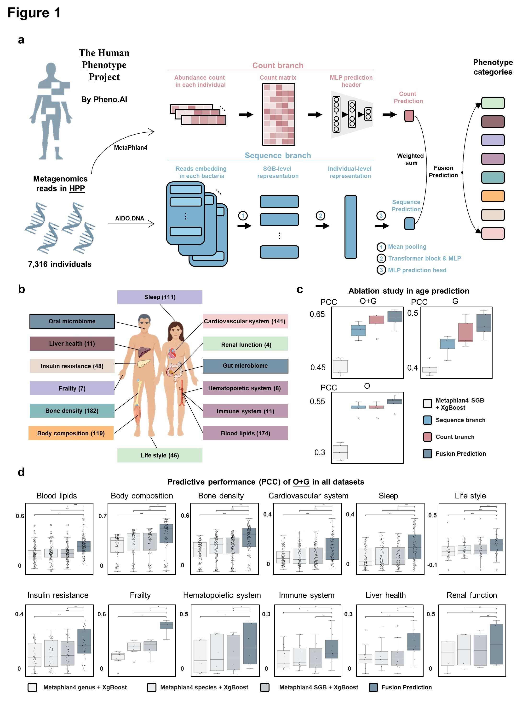

# MetaSAF integrates DNA sequence representations and microbial abundance for host phenotype prediction


## Overview

Microbial DNA sequences may provide information for host phenotype prediction beyond taxonomic abundance. We developed 
MetaSAF (Metagenomic Sequence–Abundance Fusion), a dual-branch framework that integrates read counts with sequence 
information from species-level genome bins (SGBs). Its sequence branch uses pretrained AIDO.DNA embeddings and a 
Transformer, and a learnable weighted combination integrates predictions from both branches. Using paired oral and gut 
metagenomes from 7,316 Human Phenotype Project participants, we evaluated 862 phenotype labels across 12 categories. 
MetaSAF improved prediction for most traits relative to XGBoost models based on MetaPhlAn4 abundance profiles. Without 
fine-tuning, the gut age model achieved the highest Pearson and Spearman correlations among models in seven of eight 
external cohorts. Additional analyses identified SGB-level age signals, exploratory host-genetic associations, and 
sex-stratified associations with oral microbiome age gaps. The framework also supported medication-use and 
medical-condition classification tasks. Moreover, longitudinal matching across 1,794 participants showed that 
read-derived gut representations retained individual-specific information across visits. Overall, MetaSAF strengthens 
host phenotype prediction by combining sequence and abundance information.




## Prerequisites

### Data
The HPP data contain personal information, they cannot be made publicly available in compliance with institutional 
review board (IRB) regulations. Interested bona fide researchers should contact info@pheno.ai for instructions on 
accessing the data. 

We provide a public toy data and the toy data can be download in 
[google driver](https://drive.google.com/drive/folders/14hzcQLrqsNa3MZ8gJ7bXIo3TttaoBcmY?usp=sharing)

The URL is: https://drive.google.com/drive/folders/14hzcQLrqsNa3MZ8gJ7bXIo3TttaoBcmY?usp=sharing

### Base environment

#### Declaration: All of our experiments were implemented on HPP platform.

It is recommended to use a Python version  `3.10`.

* Set up conda environment for MetaSAF:
```
conda create -n MetaSAF python==3.10
```
* Activate MetaSAF environment:
```
conda activate MetaSAF
```
* Pytorch and flash-attention are 2 key libraries for MetaSAF. When configuring a server with various CUDA versions, 
conda offers more flexible environment management. On a personal computer, however, pip often provides a quicker 
installation. The official conda and pip command and other versions of pytorch and dgl can be found from
[torch](https://pytorch.org/) and [flash-attention](https://github.com/dao-ailab/flash-attention). You need to choose the 
appropriate dependency pytorch and dgl for your own environment, and we recommend the 

## Installation MetaSAF

* You can install MetaSAF as follows:

```
git clone https://github.com/CocoGzh/MetaSAF.git
cd MetaSAF
python setup.py bdist_wheel sdist
cd dist
pip install MetaSAF-0.0.1-py3-none-any.whl
```

Notably, if you have existed python environment, you can directly download the MetaSAF package and try to import MetaSAF in 
your code. It may work, but we can't guarantee it.


## Set up jupyter lab

Once you have configured your MetaSAF environment using conda. Add MetaSAF to jupyter's core. 

* Specifically, we have installed ipykernel automatically through MetaSAF, if it does not install successfully, 
please enter the following command.
```
pip install ipykernel
```
* Then enter the following command:
```
python -m ipykernel install --user --name=MetaSAF --display-name MetaSAF
```

## BTW
In addition, if you have any problems or suggestions, please let us know in the issues section.

## Citations
If you find this method useful for your research, please consider citing the following paper:
```
MetaSAF integrates DNA sequence representations and microbial abundance for host phenotype prediction
```